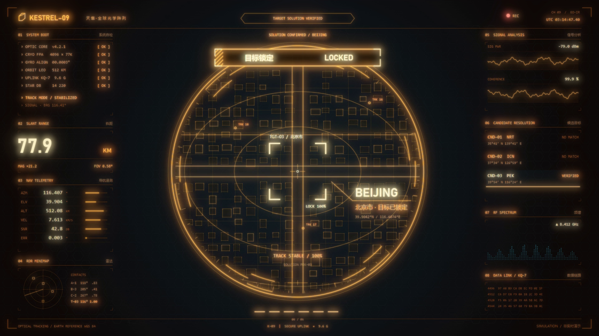

# KESTREL–09 · 北京锁定

用代码生成的 **10 秒科幻界面动效**，1920×1080、60 fps，含原创合成音效和增强辉光。

[](media/kestrel-glow.mp4)

[最终视频](media/kestrel-glow.mp4) · [辉光前原片](media/kestrel-base.mp4) · [辉光对比](docs/glow-comparison.png) · [分镜画面](docs/storyboard.png)

这是一套 HTML / JavaScript / Python 工程，不是 After Effects 工程。画面主体由 Three.js 与 Canvas 2D 绘制，Chromium 逐帧取样、FFmpeg 编码，再由 Python 对原片逐帧叠加选择性辉光。

```text
src/comp.html + sequence.js + hud-engine.js
                ↓ Chromium / 时间采样运动模糊
          build/kestrel-base.mp4
                ↓ scripts/glow.py / D 配方
          build/kestrel-glow.mp4
```

## 直接预览

双击 `src/preview.html`。可暂停、拖动时间线和重新开机，预览不需要 Node.js 或网络。浏览器需支持 WebGL 2。

浏览器中的源动画为辉光后期前的版本；最终增强辉光见 `media/kestrel-glow.mp4`，由下述后期步骤产生。不要通过修改动画内容来复现辉光。

## 安装渲染环境

建议 Python 3.10–3.12；FFmpeg、FFprobe 需要安装并加入 PATH。下面以 Windows PowerShell 为例：

```powershell
python -m venv .venv
.\.venv\Scripts\Activate.ps1
python -m pip install -r requirements.txt
python -m playwright install chromium
python scripts/check_project.py --render-smoke
```

macOS / Linux 激活环境使用 `source .venv/bin/activate`；Linux 可能需要 `python -m playwright install --with-deps chromium`。Windows 渲染默认使用 ANGLE D3D11，其他系统使用 Chromium 默认后端。

原片使用 Windows 自带 Bahnschrift、Consolas、Microsoft YaHei。字体没有打包；其他系统会使用替代字体，因此跨系统不保证逐像素一致。

## 一条命令生成完整视频

```powershell
python build.py
```

这会从动画源码重新生成 `build/kestrel-base.mp4`，然后应用 D 辉光配方，输出 `build/kestrel-glow.mp4`。默认 4 个 Chromium 工作进程；可用 `python build.py --workers 2` 降低资源占用。渲染和辉光处理都需要数分钟。

若只想复现当前已确认的辉光增强，直接处理随包原片：

```powershell
python build.py --glow-only
```

该命令保留原片的 600 帧和时间戳，直接复制 AAC 音频，只做空间辉光。`media/` 中包含已完成的原片和最终视频，`media/manifest.json` 记录校验值。

## 修改入口

| 文件 | 内容 |
| --- | --- |
| `src/sequence.js` | 10 秒编排、镜头、地图展开、准星跳转、城市网格、锁定横幅与颜色变化 |
| `src/hud-engine.js` | Three.js 地球、初始辉光、公共仪表绘制 |
| `scripts/glow.py` | 最终增强辉光；默认 `PRESETS['D']` |
| `src/score-v2.py` | 合成音效源码，固定随机种子 |
| `src/assets/` | 海岸线顶点、原始及母带音效 |
| `scripts/render.py` | 逐帧采样、线性光积分、FFmpeg 编码 |
| `scripts/check_project.py` | 素材完整性、浏览器和短片渲染检查 |

动画由 `window.__seek(t)` 定位秒数，`window.__ready` 等待初始化，`window.__meta.dur` 为 10。可打开 `src/comp.html?t=6.9` 检查指定画面。

## 节奏

0–0.9 秒开机与镜片组装；0.9–2.4 秒地球旋转搜索；2.4–3.2 秒球面展开为区域图；3.2–4.5 秒准星依次搜索东京、首尔与北京；4.5–6.6 秒推进到城市网格；6.6–8.1 秒橙色锁定横幅进入并收至顶部；8.1–9 秒校验；9–10 秒确认北京。

北京中心使用近似坐标 `39.9042°N, 116.4074°E`。海岸线来自 Natural Earth；街区和楼体是程序化示意几何，距离、频谱、雷达等为模拟数据。

## 重建 Three.js 依赖包（可选）

预览与 Python 渲染已有预构建 `src/vendor/engine.js`，不需要 npm。只有修改 Three.js 依赖时才需要 Node.js 22.12+：

```powershell
npm ci
npm run build:vendor
```

依赖入口为 `tools/vendor-entry.js`，版本锁定在 `package-lock.json`。

## 重新生成音效（可选）

```powershell
python src/score-v2.py
ffmpeg -y -i src/assets/sound-v2.wav -af "loudnorm=I=-19:TP=-4:LRA=9" -ar 48000 src/assets/sound-master-v2.wav
```

## 许可

包含 onetake 的 **PolyForm Noncommercial 1.0.0** 组件，不能把整个工程视为可自由商用的 MIT 工程。第三方许可证和 Required Notice 已保留，见 [THIRD_PARTY_NOTICES.md](THIRD_PARTY_NOTICES.md) 与 `licenses/`。本仓库未为原创项目文件另行授予统一开源许可证。

仅包含本工程需要的源码、素材和成片；不含参考图片、登录凭据、本机配置、临时帧或其他练习工程。
